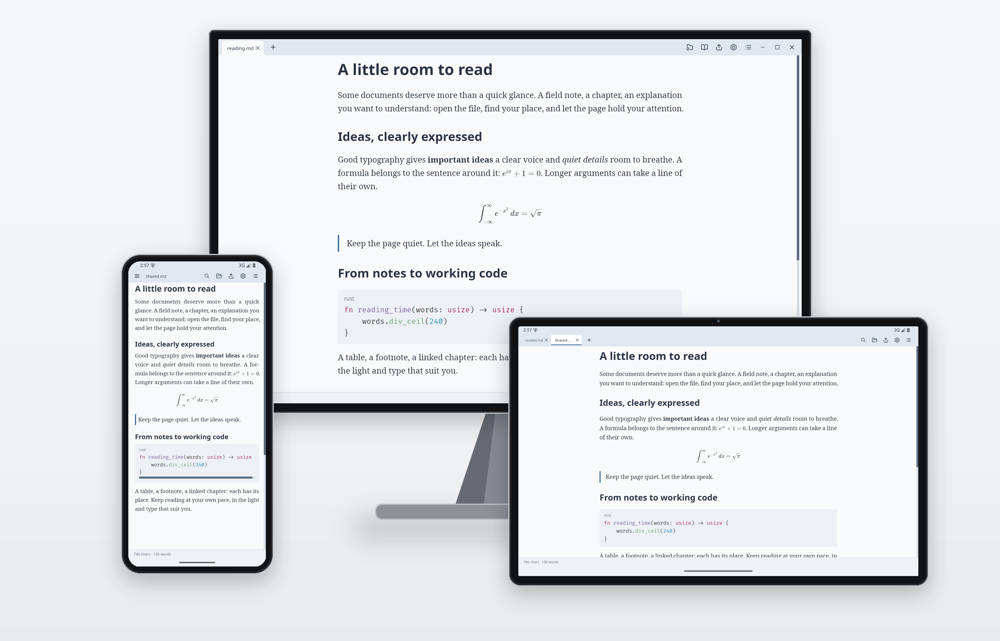
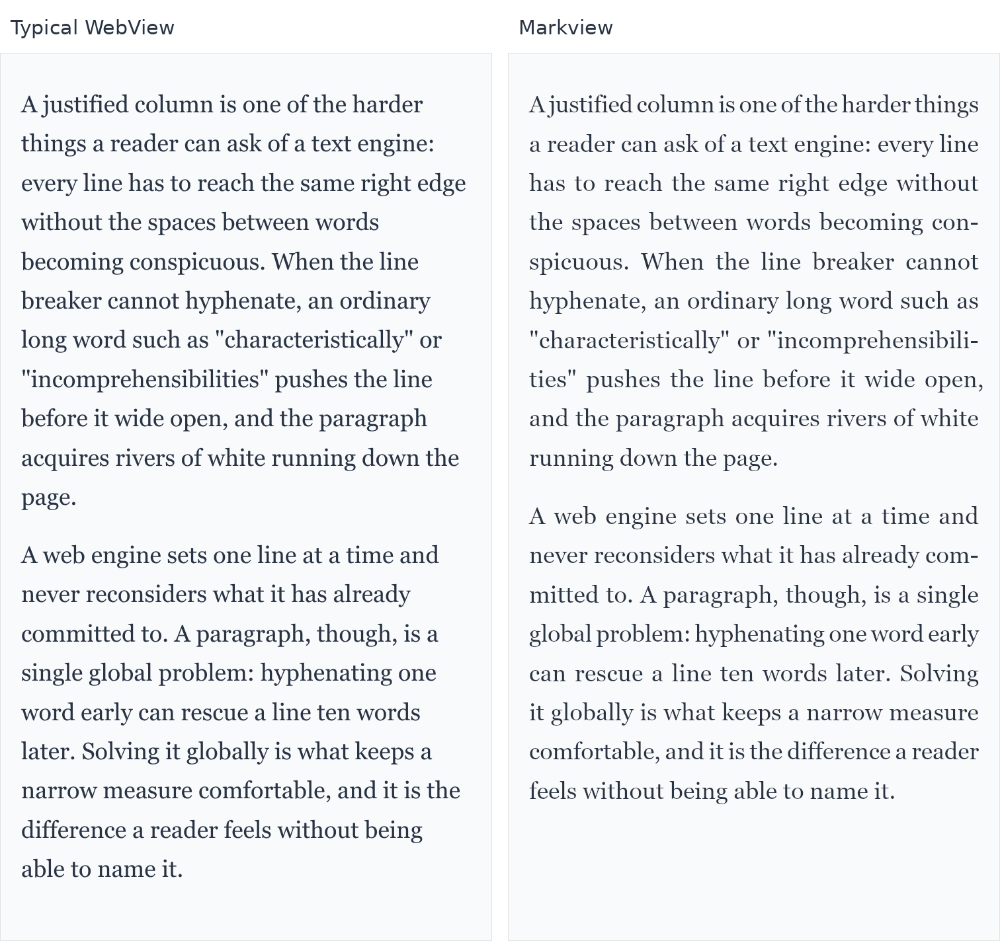
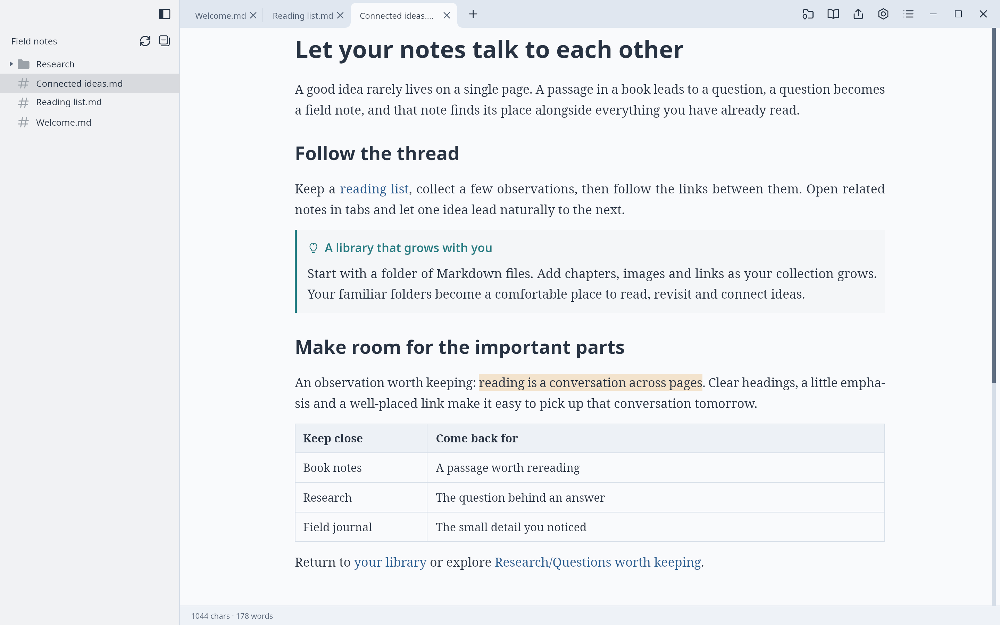
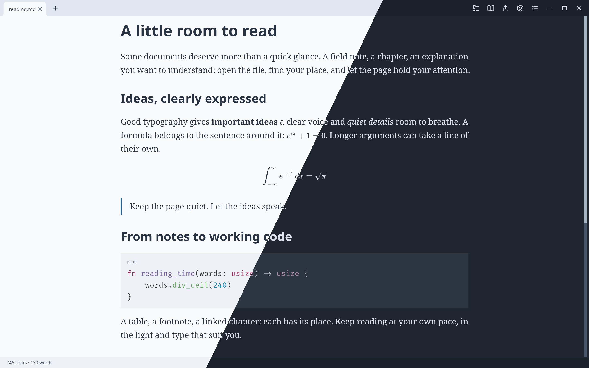

<p align="center">
  
</p>

<h1 align="center">Markview</h1>

<p align="center">
  <strong>Open quickly. Settle into reading.</strong><br>
  A lightweight, native Markdown reader for desktop and Android.<br>
  Clear text, mathematics and code, with publication-quality typography.
</p>

<p align="center">
  <strong><a href="https://github.com/szdytom/markview/releases/latest">Download Markview</a></strong> ·
  <a href="#make-it-your-page">Explore themes</a> ·
  <a href="docs/users/README.md">User guide</a>
</p>

<p align="center">
  English · <a href="README.zh-cn.md">简体中文</a>
</p>

<p align="center">
  
</p>

## Install Now

Choose your platform from the [latest release](https://github.com/szdytom/markview/releases/latest):

| Platform | Download | Getting started |
| --- | --- | --- |
| Windows | `.msi` installer or portable `.zip` | Windows 10+; the installer adds Markdown file associations |
| macOS | Zipped `.app` | Apple Silicon, macOS 11+; see the unsigned-app setup below |
| Linux | `.deb`, AppImage or `.tar.gz` | See the [runtime requirements](docs/users/installation.md#runtime-requirements) |
| Android | `.apk` | Android 9+; ARM64 phones and tablets |

Or install the `markview` command with a script:

**Linux / macOS — Shell**

```sh
curl --proto '=https' --tlsv1.2 -LsSf \
  https://github.com/szdytom/markview/releases/latest/download/markview-installer.sh | sh
```

**Windows — PowerShell**

```powershell
irm https://github.com/szdytom/markview/releases/latest/download/markview-installer.ps1 | iex
```

**Arch Linux — [AUR](https://aur.archlinux.org/packages/markview-bin)**

```sh
yay -S markview-bin
```

The AUR also offers a [source build](https://aur.archlinux.org/packages/markview).

**macOS (Apple Silicon) — [Homebrew](https://github.com/Stevvven777/homebrew-tap)**

```sh
brew install --cask Stevvven777/tap/markview
```

**Desktop:** open a Markdown file, or choose Markview from **Open with**.
**Android:** open or share a document to **Read in Markview**. Import its folder
when you want to read linked chapters and local images together.

**macOS:** after moving Markview to Applications, allow it in
**System Settings → Privacy & Security → Open Anyway**, or run:

```sh
xattr -d com.apple.quarantine /Applications/Markview.app
```

[Full installation guide](docs/users/installation.md) · [Android guide](docs/users/android.md)

## Typography that keeps the page in balance

An even right edge, without distracting gaps between words. Markview breaks
lines across the whole paragraph and hyphenates English words to balance the
text. Below, the same passage uses the same font, size and column width in a
browser's default left-aligned layout and Markview's justified layout.

<p align="center">
  
</p>

[How this comparison is rendered](docs/developers/comparison.md#the-figure)
· Text: [A Declaration of the Independence of Cyberspace](https://www.eff.org/cyberspace-independence), John Perry Barlow.

Careful CJK punctuation and native LaTeX keep text and mathematics readable,
with no separate TeX installation. Tables, highlighted code, footnotes, GitHub alerts, images and Mermaid diagrams
belong on the same page. Enjoy a focused reading space while your Markdown
files stay exactly as you wrote them.

## Read across different kinds of documents

From a favorite essay to a technical handbook or a chapter full of mathematics,
give every document a page worth settling into. Bring web articles into the
same focused reading experience.

| Long-form reading · Paragraphs and rhythm | Technical documents · Code, links and tables |
| --- | --- |
|  |  |
| [Guerilla Open Access Manifesto](https://archive.org/details/GuerillaOpenAccessManifesto) · Aaron Swartz, July 2008 | [The Rust Programming Language](https://doc.rust-lang.org/book/ch03-02-data-types.html) · Data Types |

| Mathematics · Theorems and formulas | Web articles · Focus on the text |
| --- | --- |
|  |  |
| [OpenStax Calculus Volume 3](https://openstax.org/books/calculus-volume-3/pages/6-7-stokes-theorem) · §6.7 Stokes’ Theorem | [Wikipedia: Webb’s First Deep Field](https://en.wikipedia.org/wiki/Webb%27s_First_Deep_Field) |

[Excerpts, translations and image credits](docs/screenshots/source/showcase/README.md).

## Your whole library, beautifully connected

Open a folder and turn a collection of Markdown files into your personal reading
room. Browse notes, chapters and images in the file tree, keep related documents
open in tabs, and pick up where you left off. From a project handbook to years
of reading notes, everything stays within reach.

Already have an **Obsidian vault**? Open it directly in Markview. Follow
`[[wikilinks]]` between notes and headings, enjoy image embeds, highlighted
passages and rich callouts, and rediscover your knowledge library with
publication-quality typography. Your folders and notes stay right where they are.
Obsidian compatibility is usable today and under active development, with
support continuing to grow and improve.

<p align="center">
  
</p>

Press **Ctrl+Shift+O** to open a folder on desktop. On Android, import your
vault's folder and take your reading library with you.
[Folder and vault guide](docs/users/reading.md#folders-and-obsidian-vaults)

## Make it your page

Choose a quiet light theme, a dark reading surface, or a little more character.
Find the atmosphere that makes you want to read one more page.

<p align="center">
  
</p>

Adjust fonts and text size, customize line spacing, or create your own theme.
Themes and font settings are available on desktop and Android.
[Explore the theme gallery](docs/users/themes.md) · [Reading settings](docs/users/settings.md) · [Theme guide](docs/users/stylesheets.md)

## Keep your place

- **Find what matters.** Search within a document or jump through its contents.
- **Read across chapters.** Follow Markdown links in tabs and return to saved reading positions.
- **Take something with you.** Copy text, code or formulas; export to PDF or PNG.
- **Read on your phone or tablet.** Android shares the native typesetting and themes, with touch scrolling, a phone tab drawer and tablet tabs.
- **Stay in the flow.** Edit in your favorite app and watch your open document refresh on desktop.

See the [reading guide](docs/users/reading.md) for controls and supported content.

## Publication-quality PDF export

Take the typography with you. Native PDF export preserves carefully set
paragraphs, mathematics and highlighted code, with thoughtful page breaks.
Choose paper size, margins and a print theme; add headers, footers and page
numbers. Text stays selectable, and links remain clickable.

Press **Ctrl+E** on desktop to prepare your document for sharing or printing.
[PDF and image export guide](docs/users/export.md)

## Read with peace of mind

Your documents open in a native reader that keeps your source files untouched.
Document scripts cannot run, and links that could launch a local program ask
for your confirmation. Extensive automated testing helps keep reading smooth
and dependable, down to the fonts and formulas on the page.

[Security details](docs/developers/security.md) ·
[Report a vulnerability](https://github.com/szdytom/markview/security/advisories/new)

## Lightweight, with measurements to match

| Measure | Recorded result |
| --- | --- |
| Opens ready to read | About **100 ms**, from a short note to a 1 MiB document |
| Resident memory | About **50 MiB** for an ordinary note |

<p align="center">
  <a href="docs/developers/comparison.md"></a>
</p>

Spend your attention on the page. Markview opens quickly and keeps its memory
footprint small, even as your documents grow. The chart compares opening time
and memory across four document sizes, measured on the same Linux laptop.

[Measurement method and baselines](docs/developers/performance.md#native-baseline-on-the-performance-profile) ·
[Reader and PDF comparisons](docs/developers/comparison.md) ·
[Latest downloads](https://github.com/szdytom/markview/releases/latest)

## Documentation and contributing

[User guides](docs/users/README.md) · [Android](docs/users/android.md) ·
[Build and contribute](CONTRIBUTING.md) · [Developer guides](docs/developers/README.md)

Markview is open source under the [MIT license](LICENSE).
[Third-party notices](THIRD_PARTY.md) · [All documentation](docs/README.md)
