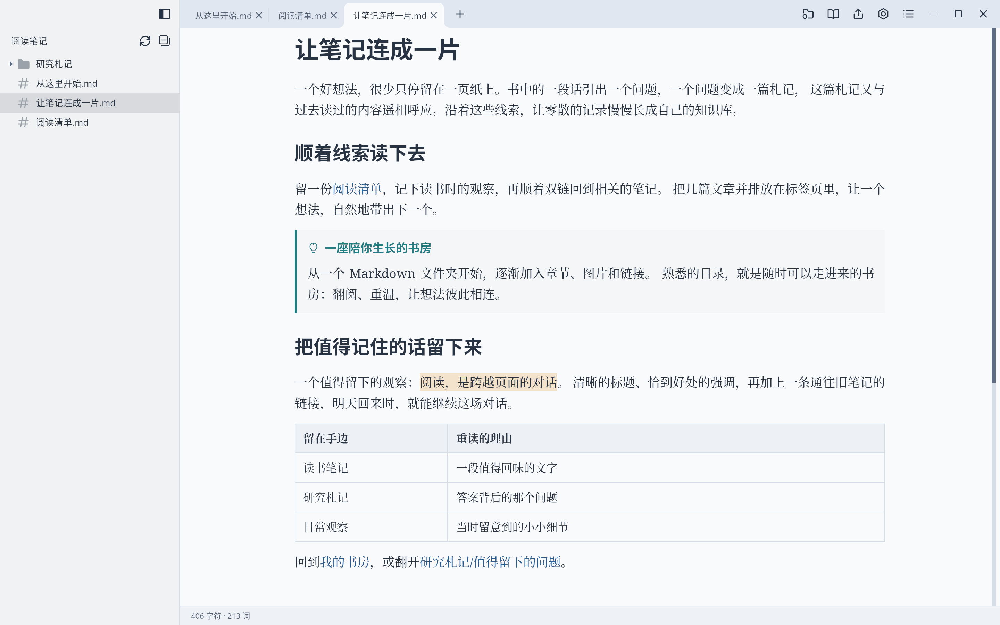

<p align="center">
  
</p>

<h1 align="center">Markview</h1>

<p align="center">
  <strong>轻快打开，安心阅读。</strong><br>
  适用于桌面与 Android 的轻巧原生 Markdown 阅读器。<br>
  正文、公式与代码清晰呈现，排版质量达到出版级。
</p>

<p align="center">
  <strong><a href="https://github.com/szdytom/markview/releases/latest">下载 Markview</a></strong> ·
  <a href="#读出自己的风格">浏览主题</a> ·
  <a href="docs/users/guide.zh-cn.md">使用指南</a> ·
  <a href="https://qm.qq.com/q/hMYoLidy0w">加入 QQ 群</a>
</p>

<p align="center">
  <a href="README.md">English</a> · 简体中文
</p>

<p align="center">
  
</p>

## 立即安装

从[最新版本](https://github.com/szdytom/markview/releases/latest)选择适合你的安装包：

| 平台 | 下载格式 | 安装说明 |
| --- | --- | --- |
| Windows | `.msi` 安装包或便携 `.zip` | Windows 10+；安装包添加 Markdown 文件关联 |
| macOS | 打包为 zip 的 `.app` | Apple Silicon、macOS 11+；未签名应用的设置见下方 |
| Linux | `.deb`、AppImage 或 `.tar.gz` | 请查看[运行要求](docs/users/installation.md#runtime-requirements) |
| Android | `.apk` | Android 9+；ARM64 手机与平板 |

也可以通过脚本安装 `markview` 命令：

**Linux / macOS — Shell**

```sh
curl --proto '=https' --tlsv1.2 -LsSf \
  https://github.com/szdytom/markview/releases/latest/download/markview-installer.sh | sh
```

**Windows — PowerShell**

```powershell
irm https://github.com/szdytom/markview/releases/latest/download/markview-installer.ps1 | iex
```

**Arch Linux — [AUR](https://aur.archlinux.org/packages/markview-bin)**

```sh
yay -S markview-bin
```

AUR 也提供[源码构建包](https://aur.archlinux.org/packages/markview)。

**macOS (Apple Silicon) — [Homebrew](https://github.com/Stevvven777/homebrew-tap)**

```sh
brew install --cask Stevvven777/tap/markview
```

**桌面版：**打开 Markdown 文件，或在**打开方式**中选择 Markview。**Android：**打开或分享文档时选择**在 Markview 中阅读**。如果文档包含本地图片或相邻章节，请导入所在文件夹。

**macOS：**将 Markview 移入“应用程序”后，在**系统设置 → 隐私与安全性**中点击**仍要打开**，或运行：

```sh
xattr -d com.apple.quarantine /Applications/Markview.app
```

[完整安装指南](docs/users/installation.md) · [Android 使用指南](docs/users/android.md)

## 齐整的右边缘，均衡的段落

让正文的右边缘齐整，也让词间距保持自然。Markview 从整个段落安排换行，结合英文断字，平衡每一行的文字。下图用相同的文字、字体、字号和栏宽，对比浏览器默认的左对齐与 Markview 的两端对齐。

<p align="center">
  
</p>

[对比图的渲染方法](docs/developers/comparison.md#the-figure) · 选文：[《网络空间独立宣言》](https://www.eff.org/cyberspace-independence)，John Perry Barlow。

细致的中文标点处理与原生 LaTeX，让正文和公式自然融为一体，无须另行安装 TeX。表格、语法高亮代码、脚注、GitHub 提示块、图片与 Mermaid 图表，都在同一页上清晰呈现。专心享受阅读，Markdown 源文件始终保持原样。

## 阅读不同的内容

从喜欢的长文、常翻的技术手册，到满页公式的数学教材，每一份文档都值得好好排版。网页文章也能带进来，在同样清爽的页面里专心读下去。

| 普通长文 · 段落与阅读节奏 | 技术文档 · 代码、链接与表格 |
| --- | --- |
|  |  |
| [《游击队开放访问宣言》](https://archive.org/details/GuerillaOpenAccessManifesto) · Aaron Swartz · 2008 年 7 月 | [《Rust 程序设计语言》](https://kaisery.github.io/trpl-zh-cn/ch03-02-data-types.html) · 数据类型 |

| 数学文档 · 定理与公式 | 网页转写 · 专注文章本身 |
| --- | --- |
|  |  |
| [OpenStax《微积分》第三卷](https://openstax.org/books/calculus-volume-3/pages/6-7-stokes-theorem) · 6.7 斯托克斯定理节选译文 | [维基百科《韦伯的首次深空》](https://zh.wikipedia.org/wiki/%E9%9F%8B%E4%BC%AF%E7%9A%84%E9%A6%96%E6%AC%A1%E6%B7%B1%E7%A9%BA) · 简体页面 |

[选段、翻译与图片来源](docs/screenshots/source/showcase/README.md)。

## 把整个文件夹，变成你的阅读书房

打开一个文件夹，就拥有一座井然有序的文档库。在文件树中浏览笔记、章节与图片，用多个标签页串起相关内容，下次打开时接着上次的位置读。无论是一整套项目手册，还是积累多年的读书笔记，都能轻松翻阅、自在切换。

已有 **Obsidian Vault 笔记库**？直接用 Markview 打开。沿着 `[[双链]]` 穿梭于笔记与章节之间，让嵌入图片、高亮文字和丰富的标注框一同呈现，为熟悉的知识库换上出版级排版。文件还在原来的目录里，打开就能读。Obsidian 兼容目前已初步可用，仍在活跃开发与持续完善中。

<p align="center">
  
</p>

桌面版按 **Ctrl+Shift+O** 打开文件夹；Android 导入笔记库文件夹，就能把整座书房带在身边。[文件夹与笔记库使用指南](docs/users/reading.md#folders-and-obsidian-vaults)

## 读出自己的风格

明亮或沉静，由你选择。找到喜欢的字体与底色，让每次打开文档，都想再多读一页。

<p align="center">
  
</p>

调整字体、字号与行距，也可以创建自己的主题。桌面与 Android 均支持主题和字体设置。[浏览完整主题展示](docs/users/themes.md) · [阅读设置](docs/users/settings.md) · [主题指南](docs/users/stylesheets.md)

## 顺着自己的节奏读

- **找到重点。**搜索文档内容，或通过目录直达章节。
- **连着读下去。**在标签页中打开 Markdown 链接，回到保存的阅读位置。
- **带走需要的内容。**复制正文、代码与公式，或导出 PDF、PNG。
- **在手机与平板上阅读。**Android 共享原生排版与主题，支持触摸滚动、手机标签抽屉和平板标签栏。
- **跟上写作的节奏。**在喜欢的应用中编辑，桌面版会自动刷新已打开的文档。

操作方式与支持的内容见[中文使用指南](docs/users/guide.zh-cn.md)。

## 高质量 PDF 导出

把精心排版的页面带走。原生 PDF 导出保留正文、公式与代码高亮，妥善处理分页。可以选择纸张大小、页边距与打印主题，添加页眉、页脚和页码。导出后文字仍可选取，链接仍可点击。

桌面版按 **Ctrl+E**，轻松准备一份适合分享或打印的文档。[PDF 与图片导出指南](docs/users/export.md)

## 放心打开，安心阅读

Markview 在原生阅读器中呈现文档，完整保留你的源文件。文档中的脚本无法运行，可能启动本地程序的链接会先征求你的确认。从字体、公式到整页排版，持续的自动化测试让每一次阅读都更稳定、顺畅。

[了解安全设计](docs/developers/security.md) · [报告安全问题](https://github.com/szdytom/markview/security/advisories/new)

## 轻巧，也有实测依据

| 项目 | 已记录的结果 |
| --- | --- |
| 打开即可阅读 | 约 **100 ms**，从短篇笔记到 1 MiB 长文 |
| 常驻内存 | 普通笔记约 **50 MiB** |

<p align="center">
  <a href="docs/developers/comparison.md"></a>
</p>

把时间留给内容。Markview 轻快打开，低内存常驻，长文也能从容读。上图展示在同一台 Linux 笔记本上，四种文档大小的打开速度与内存占用对比。

[测量方法与完整基线](docs/developers/performance.md#native-baseline-on-the-performance-profile) · [阅读器与 PDF 导出对比](docs/developers/comparison.md) · [下载最新版本](https://github.com/szdytom/markview/releases/latest)

## 文档与贡献

[中文使用指南](docs/users/guide.zh-cn.md) · [Android](docs/users/android.md) · [构建与贡献](CONTRIBUTING.md) · [开发者文档](docs/developers/README.md)

Markview 以 [MIT 许可证](LICENSE)开源。[第三方声明](THIRD_PARTY.md) · [完整文档导航](docs/README.md)

## 交流与反馈

欢迎加入 [Markview QQ 群](https://qm.qq.com/q/hMYoLidy0w)，交流阅读体验、分享主题与反馈问题。群号：**584396685**。
