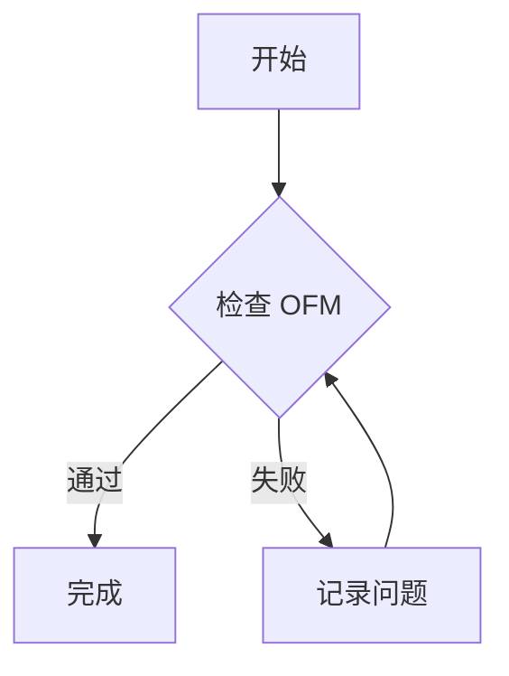
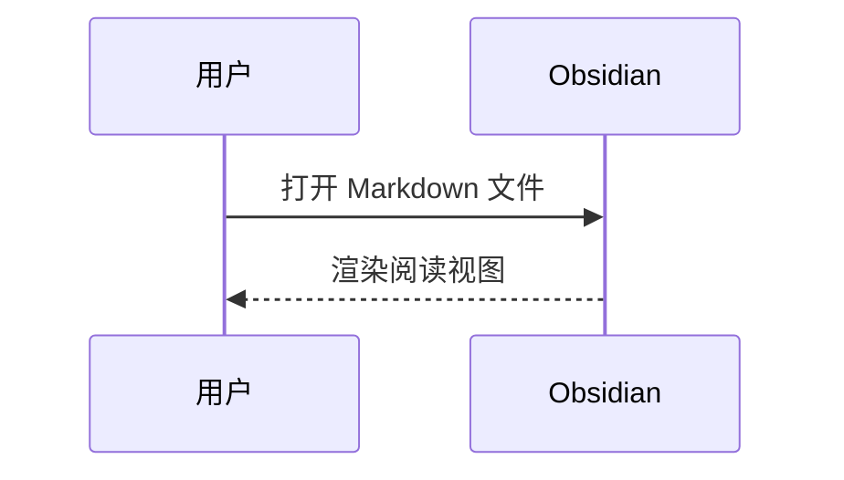

# OFM 完整格式测试文档

> [!info] 使用说明
> 此文档用于检查 Obsidian Flavored Markdown (OFM) 的渲染效果。部分测试需要在 Vault 内创建同名笔记、图片、PDF 或其他附件。建议分别检查阅读视图和实时预览。

## 1. 标题

# 一级标题
## 二级标题
### 三级标题
#### 四级标题
##### 五级标题
###### 六级标题

一级标题（Setext）
==================

二级标题（Setext）
------------------

## 2. 段落、换行与分隔线

这是第一段，包含中文、English、数字 123。
这是同一段的下一行（普通软换行）。  
这里使用两个尾随空格强制换行。

这是新的段落。

---

***

___

## 3. 行内文本格式

普通文本、**粗体**、__粗体__、*斜体*、_斜体_、***粗斜体***、~~删除线~~、==高亮==、`行内代码`。

组合：**粗体内的 *斜体***、==**高亮粗体**==、~~**粗体删除线**~~。

转义：\*不应斜体\*、\[不是链接\]、\#不是标题、\`不是代码\`。

特殊字符：< > & " ' © → ← — … 😀 中文标点，。！？

上标/下标（HTML）：H<sub>2</sub>O，x<sup>2</sup>（取决于渲染环境）。

## 4. 引用与嵌套

> 一级引用
> 第二行
>
> > 二级引用
> > **引用中的粗体**和 `代码`
>
> - 引用内列表项 A
> - 引用内列表项 B

## 5. 列表

- 无序列表 A
- 无序列表 B
  - 二级项目
    - 三级项目
- 无序列表 C

* 星号列表
+ 加号列表

1. 有序项目一
2. 有序项目二
   1. 子项目一
   2. 子项目二
3. 有序项目三

5. 从 5 开始的有序列表
6. 下一项

- 混合列表
  1. 编号项目
  2. 第二项
     - 再次嵌套

- 包含多个段落的列表项

  列表项的第二段。

- 下一个列表项

## 6. 任务列表

- [ ] 未完成任务
- [x] 已完成任务
- [ ] 父任务
  - [x] 已完成子任务
  - [ ] 未完成子任务

> [!note] 说明
> Obsidian 对 `- [ ]` 和 `- [x]` 提供原生任务复选框。`- [/]`、`- [-]` 等扩展状态依赖主题或插件，不属于基础 OFM 的通用保证。

## 7. 链接

[Obsidian 官方网站](https://obsidian.md)

[带标题的链接](https://obsidian.md "Obsidian")

<https://obsidian.md>

<hello@example.com>

[引用式链接][obsidian-help]

[obsidian-help]: https://help.obsidian.md "Obsidian Help"

### 7.1 WikiLinks（需在 Vault 内验证）

[[测试目标笔记]]

[[测试目标笔记|自定义显示文本]]

[[测试目标笔记#目标标题]]

[[测试目标笔记#目标标题|跳转到标题]]

[[测试目标笔记#^target-block]]

[[测试目标笔记#^target-block|跳转到块]]

[[#标题]]

[[#^local-block]]

### 7.2 Markdown 格式内部链接

[目标笔记](测试目标笔记.md)

[目标标题](测试目标笔记.md#目标标题)

## 8. 图片与附件嵌入（需准备附件）


![[ofm-test.png]]

![[ofm-test.png|300]]

![[ofm-test.png|300x200]]

![[测试目标笔记]]

![[测试目标笔记#目标标题]]

![[测试目标笔记#^target-block]]

![[sample.pdf]]

![[sample.pdf#page=2]]

![[sample.mp3]]

![[sample.mp4]]

> [!warning] 附件依赖
> 图片、PDF、音频、视频必须存在于 Vault 中；嵌入的显示效果还取决于文件类型和平台支持。

## 9. 表格（GFM）

| 左对齐 | 居中 | 右对齐 |
| :--- | :---: | ---: |
| 文本 | **粗体** | 123 |
| `code` | ==高亮== | 45.67 |
| 中文 | [链接](https://obsidian.md) | -9 |

### 9.1 表格内的竖线转义

| 类型 | 示例 |
| --- | --- |
| 转义竖线 | A \| B |
| WikiLink 别名 | [[测试目标笔记\|别名]] |

## 10. 代码

行内代码：`const value = 42;`

包含反引号的行内代码：`` `code` ``。

```javascript
function greet(name) {
  console.log(`Hello, ${name}!`);
}
greet("OFM");
```

```python
from dataclasses import dataclass

@dataclass
class Item:
    name: str
    count: int = 1

print(Item("Markdown", 3))
```

```json
{
  "name": "OFM",
  "enabled": true,
  "count": 3,
  "items": ["a", "b"]
}
```

```
无语言标识的纯文本代码块
**此处不应变成粗体**
[[此处不应变成内部链接]]
```

    四空格缩进代码块
    **仍然是原样代码**

## 11. 数学公式（LaTeX / MathJax）

行内数学：$E = mc^2$、$a^2+b^2=c^2$、$\alpha+\beta=\gamma$。

独立数学公式：

$$
\int_{-\infty}^{\infty} e^{-x^2}\,dx = \sqrt{\pi}
$$

矩阵：

$$
A = \begin{bmatrix}
1 & 2 \\
3 & 4
\end{bmatrix}
$$

分段函数：

$$
f(x)=\begin{cases}
x^2, & x \ge 0 \\
-x, & x < 0
\end{cases}
$$

求和：$\displaystyle \sum_{i=1}^{n}i=\frac{n(n+1)}{2}$。

## 12. 脚注

这是一条普通脚注[^basic]，也是一条具名脚注[^named]。

这里还有一条行内脚注。^[这是 Obsidian 支持的行内脚注示例。]

[^basic]: 这是普通脚注的内容。
[^named]: 这是具名脚注。

    脚注中的第二段，检查缩进和多段渲染。

## 13. 注释

显示文本 %%这部分注释在阅读视图中应隐藏%% 继续显示。

%%
这是多行注释。
**这里不应作为可见正文渲染。**
[[隐藏的内部链接]]
%%

## 14. Callouts 提示块

> [!note] Note 标题
> 普通说明内容。

> [!abstract] Abstract 标题
> 摘要内容。

> [!info] Info 标题
> 信息内容。

> [!todo] Todo 标题
> 待办内容。

> [!tip] Tip 标题
> 提示内容。

> [!success] Success 标题
> 成功内容。

> [!question] Question 标题
> 问题内容。

> [!warning] Warning 标题
> 警告内容。

> [!failure] Failure 标题
> 失败内容。

> [!danger] Danger 标题
> 危险内容。

> [!bug] Bug 标题
> 缺陷内容。

> [!example] Example 标题
> 示例内容。

> [!quote] Quote 标题
> 引用内容。

### 14.1 折叠 Callouts

> [!faq]- 默认折叠
> 点击标题后展开。
> - 项目一
> - 项目二

> [!tip]+ 默认展开
> 点击标题后折叠。

### 14.2 嵌套 Callouts

> [!note] 外层
> 外层内容。
> > [!warning] 内层
> > 内层内容，包含 **粗体** 和 $x^2$。

### 14.3 无自定义标题

> [!info]
> 使用默认标题。

## 15. 块 ID 与块引用

这是当前笔记的一个可引用段落。 ^local-block

- 带块 ID 的列表项 ^list-block

引用当前笔记的块：[[#^local-block]]。

嵌入当前笔记的块（测试递归嵌入行为）：

![[#^local-block]]

## 16. HTML（有限支持）

<kbd>Ctrl</kbd> + <kbd>K</kbd>

<mark>HTML mark</mark>

<details>
<summary>点击展开 HTML details</summary>

这是 HTML 容器中的文本。**Markdown 加粗不应在 HTML 容器内部解析**。

</details>

<!-- 这是 HTML 注释，不应显示 -->

<div>HTML 容器里的 **Markdown 语法** 不应被解析为粗体。</div>

> [!important] HTML 限制
> Obsidian 不解析 HTML 元素内部的 Markdown；HTML 的实际显示还可能受安全策略影响。

## 17. Mermaid 图表





## 18. Obsidian 属性 / Frontmatter

本文件顶部包含 YAML 属性：`title`、`aliases`、`tags`、`cssclasses`、`status`、`rating`、`published`、`created`、`sample_date` 和 `sample_list`。

检查属性面板中各字段是否显示、类型是否正确；属性并非普通正文 Markdown。

## 19. 标签与搜索语法

普通标签：#ofm #markdown/test #测试标签

行内文本与标签相邻：测试 #tag/subtag 完成。

下面仅展示搜索语法文本，不会自动执行搜索：

`tag:#ofm`、`file:OFM`、`path:测试`

## 20. 特殊字符与边界情况

URL 自动识别：https://obsidian.md

电子邮件自动识别：hello@example.com

标点：`* _ ~ = | [ ] ( ) { } # > ! \\`。

长文本：这是一段用于检查中英文混排、自动换行和长段落布局的文字。The quick brown fox jumps over the lazy dog. 0123456789. 重复测试文本以观察不同窗口宽度下的排版行为。

空行之后的内容。

### 20.1 特殊语法作为普通文本

\[\[不是 WikiLink\]\]

\!\[\[不是嵌入\]\]

\=\=不是高亮\=\=

\%\%不是注释\%\%

### 20.2 组合压力测试

> [!example] 混合语法
> **粗体**、*斜体*、==高亮==、`code`、$a+b=c$、[[测试目标笔记|WikiLink]]。
>
> - [ ] 引用块中的任务
> - [x] 已完成任务
>
> | 字段 | 值 |
> | --- | --- |
> | 测试 | **通过** |

## 21. Obsidian 额外功能（需插件或环境）

### 21.1 Dataview（非原生 OFM，需社区插件）

```dataview
TABLE file.mtime AS 修改时间
FROM #ofm
SORT file.mtime DESC
```

### 21.2 Tasks 插件查询（非原生 OFM）

```tasks
not done
```

### 21.3 Canvas

Canvas 是 `.canvas` 文件格式，不是 Markdown 语法；应另行测试。

## 22. 测试记录

| 测试模块 | 阅读视图 | 实时预览 | 备注 |
| --- | :---: | :---: | --- |
| 标题 / 段落 / 分隔线 | ☐ | ☐ | |
| 行内格式 / 转义 | ☐ | ☐ | |
| 引用 / 列表 / 任务 | ☐ | ☐ | |
| Markdown 链接 / WikiLinks | ☐ | ☐ | |
| 图片 / PDF / 媒体嵌入 | ☐ | ☐ | 需附件 |
| 表格 / 代码块 | ☐ | ☐ | |
| 数学公式 | ☐ | ☐ | |
| 脚注 / 注释 | ☐ | ☐ | |
| Callouts / 折叠 / 嵌套 | ☐ | ☐ | |
| 块 ID / 块嵌入 | ☐ | ☐ | |
| HTML | ☐ | ☐ | |
| Mermaid | ☐ | ☐ | |
| YAML 属性 / 标签 | ☐ | ☐ | |
| 插件扩展 | ☐ | ☐ | 可选 |

---

## 附录 A：测试目标笔记内容

在 Vault 中另建 `测试目标笔记.md`，填入以下内容以测试内部链接与嵌入：

```text
# 测试目标笔记

## 目标标题

这是用于标题链接测试的段落。

这是用于块链接测试的段落。 ^target-block
```

## 附录 B：附件清单

将以下文件放入 Vault 的合适位置，并确保链接能解析：

- `assets/ofm-test.png`（普通 Markdown 图片）
- `ofm-test.png`（WikiLink 图片）
- `sample.pdf`（建议至少 2 页）
- `sample.mp3`
- `sample.mp4`

## 附录 C：测试范围说明

本文覆盖 Obsidian 官方文档中的主要 Markdown 语法与扩展，另提供常见组合与边界测试。具体渲染行为可能因 Obsidian 版本、主题、平台、设置及插件而不同。Dataview 和 Tasks 查询不是 OFM 核心语法。

官方参考：https://help.obsidian.md/obsidian-flavored-markdown
