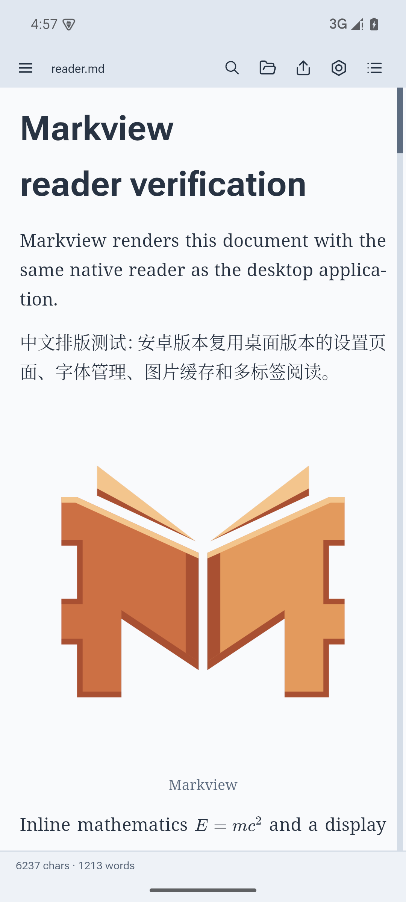
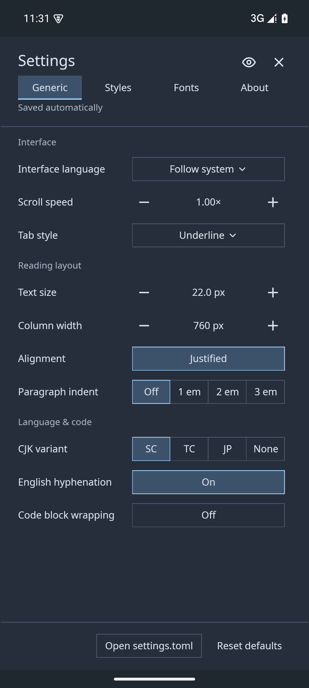
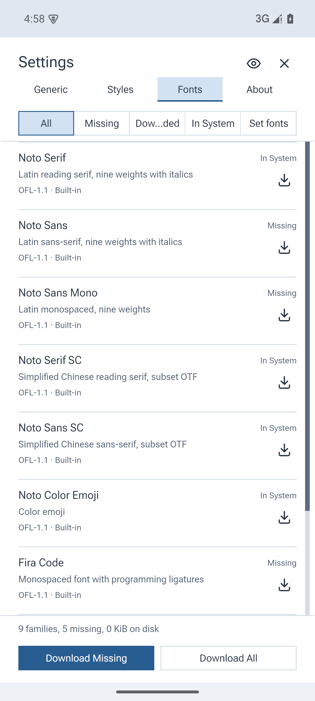
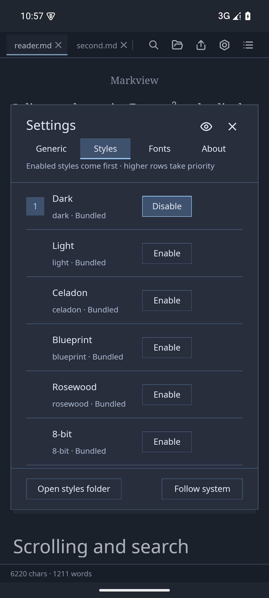
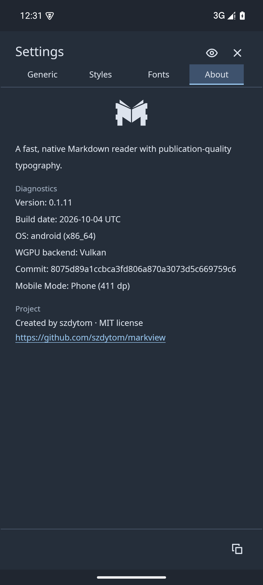
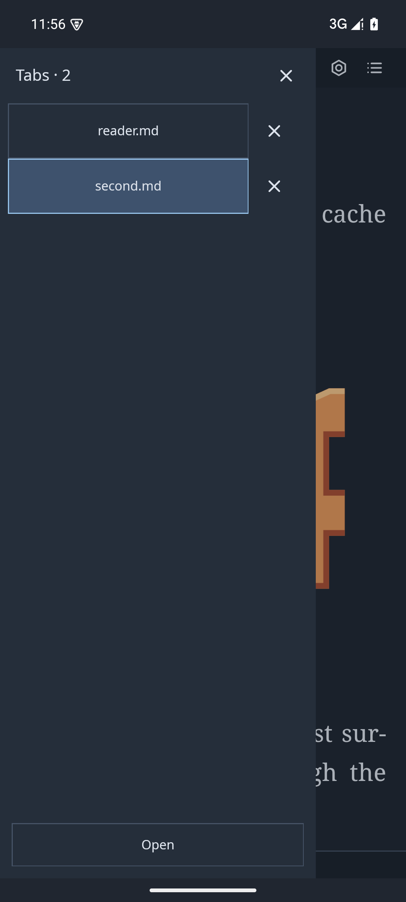
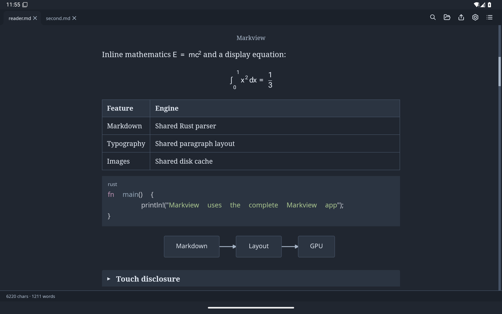
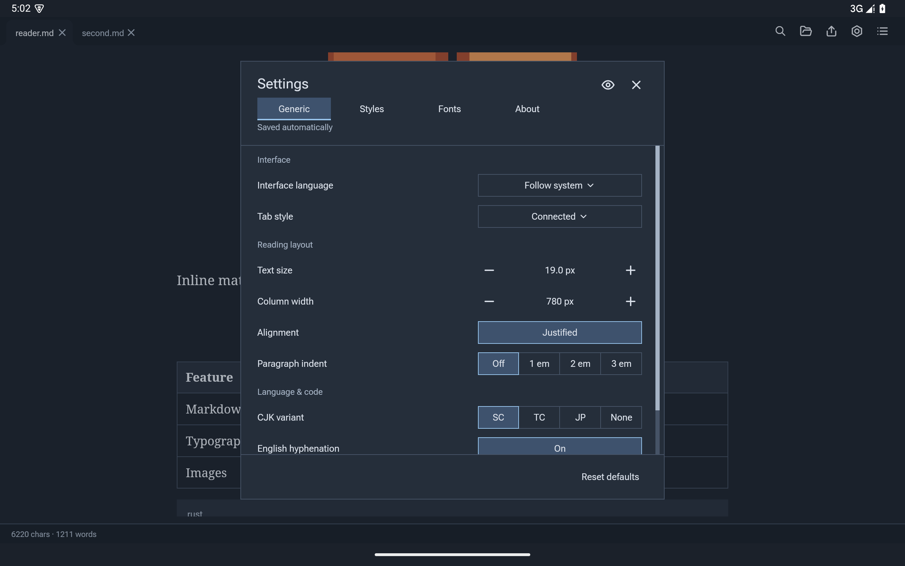

# Read on Android

Install the APK from [Releases](https://github.com/szdytom/markview/releases) on
Android 11 or newer. The release APK targets ARM64. Settings, fonts, themes,
search and export use the shared native reader.

## Open a file or folder

Use **Open file** for a single document, or **Open folder** for a collection.
Folder access asks for Android's **All files access** permission, then reads the
chosen shared-storage directory in place. External edits, relative images and
neighboring Markdown links work there. See [folder navigation](reading.md#folders-and-obsidian-vaults).

A separately opened file is an imported copy because its grant does not include
the parent directory. Reopen it to refresh it, or open its folder to follow edits
and access sibling resources. Recent workspaces reopen previously chosen folders.

## Receive shared content

Choose **Read in Markview** from Android's Open with or Share menu. File attachments
open as documents; shared text opens as Markdown and HTTP(S) URLs use web reading.
When both a file and text are supplied, the attachment wins. Some generic file
providers offer Markview for non-Markdown attachments because Android cannot
filter them by display filename.

On Android versions that send web links straight to the default browser, use
that browser's Share menu. Web reading supports static articles, not login or
JavaScript-dependent pages.

## Navigate on a phone or tablet

Phones use one left sidebar with Tabs and Folders pages. Open it from the top-left
button or swipe right; choose a document, tap outside or press Back to dismiss.
Swipe left for Contents. Back closes search or a panel before backgrounding the app.

Devices with smallest width below 600 dp use phone mode and portrait orientation;
larger devices retain the desktop tab strip and support landscape. Phone reading
uses available width; tablets keep adjustable columns. Narrow settings pages fill
the content area. **Copy diagnostics** reports the selected mode.

Tabs and positions survive rotation and Activity recreation. Settings and fonts
live in private app storage, so desktop “open settings/fonts folder” controls are
absent. Scroll speed is hidden because it does not affect touch scrolling.

## Export

The export panel uses Android's save dialog, then opens the result in an installed
viewer. Watched exports update the selected destination. Reader and export
preferences remain independent; see [Export](export.md).

## Screenshots

Captured from API 35 Pixel 6 and Pixel Tablet x86_64 emulators during the
integration suite. The screens reuse the desktop UI with phone adaptation.

| Reader | Fullscreen settings |
|---|---|
|  |  |
| Font manager | Dark styles |
|  |  |

Android layout diagnostics:

Phones share one left sidebar for **Tabs** and **Folders**. Use the top-left
sidebar button or swipe right to open it, then switch pages at the top. Each
list keeps its own scroll position. Folder browsing includes an **Open folder**
button even before a folder has been selected. Back, the scrim or a left swipe
closes either page; choosing a document also returns to reading.

**Sidebar width** applies to both pages on phones; tablet folder and outline
widths remain independent.

The Tabs page:

Tablets retain desktop tabs and support landscape:

Wide screens retain the centered settings dialog:

